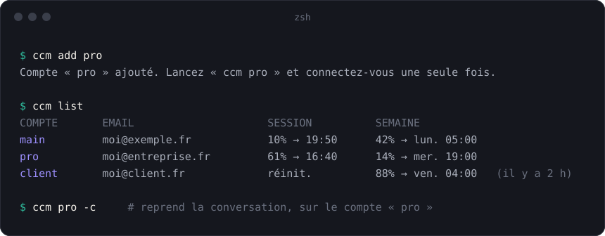

<p align="center">
  
</p>

<h1 align="center">ccm</h1>

<p align="center">
  Changer de compte Claude Code sans se reconnecter, en gardant les mêmes conversations.
</p>

<p align="center">
  
</p>

```sh
ccm add pro          # une fois par compte
ccm pro              # 1er lancement : connexion, puis plus jamais
ccm pro -c           # reprend la dernière conversation du dossier, sur le compte « pro »
ccm perso --resume   # toute option après le nom est passée à claude
ccm list             # nom, email, usage session (5 h) et semaine
ccm rename pro boulot
ccm rm boulot        # supprime le compte et sa connexion, pas les conversations
```

`main` est votre `~/.claude` habituel, déjà connecté.

## Fonctionnement

Chaque compte a son propre dossier de configuration (`~/.ccm/accounts/<id>`), passé à
Claude Code par `CLAUDE_CONFIG_DIR`. Claude Code range alors sa connexion dans une entrée
du trousseau macOS propre à ce dossier : plusieurs comptes restent connectés en même
temps, et peuvent tourner dans des terminaux différents.

Dans chaque dossier, des liens pointent vers `~/.claude` pour ce qui est partagé :
`projects` (les conversations), `history.jsonl`, `CLAUDE.md`, `settings.json`,
`plugins`, `skills`, `commands`, `hooks`, `agents`, `output-styles`, `file-history`,
`todos`, `plans`, `keybindings.json`.

Les noms sont des liens dans `~/.ccm/profiles/` : renommer ne change pas le dossier,
donc pas la connexion.

## Usage dans `ccm list`

`ccm list` demande l'usage en direct à l'API d'Anthropic (`/api/oauth/usage`, celle
qu'utilise `/usage` dans Claude Code), avec le jeton de chaque compte lu dans le trousseau.
Le jeton est passé à `curl` par l'entrée standard, jamais en argument.

Les comptes sont interrogés en parallèle. Chaque relevé est gardé 60 s dans `~/.ccm/usage/`
(réglable avec `CCM_USAGE_TTL`) : relancer `ccm list` pendant ce délai ne fait aucun appel.
L'API limite le nombre d'appels : après une réponse 429, `ccm` attend le délai `retry-after`
avant de réinterroger le compte et affiche entre-temps le dernier relevé, avec son âge.

Le jeton dure environ 8 h et `ccm` ne le renouvelle pas (c'est Claude Code qui le fait au
lancement). Si le jeton a expiré ou si l'appel échoue, `ccm list` affiche le relevé le plus
récent entre le sien et celui que Claude Code a mis en cache, suivi de son âge entre
parenthèses, par exemple « (il y a 2 h · jeton expiré) ».

## Installation

macOS uniquement, avec Claude Code déjà installé.

```sh
curl -fsSL https://raw.githubusercontent.com/freezer71/ccm/main/install.sh | zsh
```

Prérequis, `PATH`, mise à jour et désinstallation : voir [INSTALL.md](INSTALL.md).

## Tests

```sh
zsh test/ccm_test.zsh
```

## Licence

[MIT](LICENSE). Projet indépendant, sans lien avec Anthropic.
